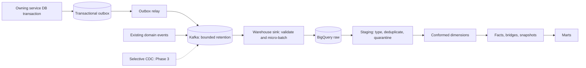

# ELT, event, and CDC pipeline

Owner: BDC Hub platform/data team, with each source service owning its contracts.
Status: target design, with an implemented bounded LMS capture/batch-load slice
and logical BigQuery views. Continuous ingestion and the broader CDC/SCD pipeline
are not deployed. The [active setup](05-bigquery-setup.md) documents the owner's
billing-disabled choice and its limits.

## 1. Design goals

Capture analytical events without making user requests wait for BigQuery, preserve
committed business changes, support replay, and bound memory/disk usage on K3s.
New business mutations requiring reliable publication use a transactional outbox.
Existing best-effort events do not acquire lossless delivery simply by adding a sink.

Use ELT: normalize the source contract, retain approved raw events, and perform
dimensional transformations in BigQuery. At the edge, apply privacy filtering,
schema validation, and payload limits before warehouse persistence.

## 2. Canonical flow



Delivery is at least once from outbox to Kafka and from Kafka to raw. Stable event
IDs, source versions, and deterministic transformations make core results repeatable.
This does not provide a distributed exactly-once transaction across Kafka and BigQuery.
Ordering holds within a partition, not across topics or partitions. Resolve source
updates using authoritative source versions/LSNs; ingestion order is only a tie-breaker.

## 3. Event envelope and compatibility

New event families use a versioned contract, for example:

```json
{
  "event_id": "019f0000-0000-7000-8000-000000000001",
  "event_type": "lms.enrollment.created",
  "schema_version": 1,
  "occurred_at": "2026-08-31T10:15:32.123Z",
  "produced_at": "2026-08-31T10:15:32.140Z",
  "producer": "lms-service",
  "environment": "prod",
  "actor": {
    "user_id": 295,
    "actor_type": "USER",
    "organization_id": 7
  },
  "context": {
    "request_id": "example-request",
    "trace_id": "example-trace",
    "session_id": "example-session",
    "course_id": 58,
    "lesson_id": 120
  },
  "subject": {"type": "enrollment", "id": "991"},
  "privacy_class": "INTERNAL",
  "payload": {}
}
```

- Keep UTC event/production times; apply reporting timezones explicitly downstream.
- Reuse the same `event_id` on retry. Scope identity by producer/event family if
  source IDs are not globally unique.
- Accept additive optional fields. Breaking changes use a new versioned topic
  with an explicit migration; support the agreed old/new versions during rollout.
- `actor` identifies the initiator; `subject` identifies the affected entity.
- Exclude passwords, authorization headers, keys, raw content, and file bodies.
- Proposed payload limit: 64 KiB. Object references must also satisfy access/privacy policy.

For existing `lms.analytics.interactions`, preserve `interaction_id` and derive a
namespaced canonical event key in the sink adapter. Preserve `event_id` from
`recommender.interactions.v1`. Do not require envelope changes in producers just
to start Phase 1, and do not generate a fresh random ID on each consumption.

## 4. Capture selection

| Need | Mechanism | Reason |
|---|---|---|
| Login attempt, feature interaction, recommendation impression | Durable domain telemetry where needed | May have no corresponding state row |
| New enrollment/course/lab mutation | Transactional outbox | Atomic publication intent with the business write |
| Existing dimension changes without domain events | Selective CDC, Phase 3 | Capture insert/update/delete with a narrow allowlist |
| Initial history/backfill | Consistent source-owned snapshot | CDC cannot recreate history before its capture point |
| Reconciliation | Source-owned export/API with `(updated_at, primary_key)` cursor | Detect missing rows and drift |
| High-volume clicks/heartbeats | Client aggregation, rate limits, documented sampling | Bound transport and storage costs |

A warehouse consumer must not query another service's database directly. An
explicit CDC/export integration is provisioned and owned by that source service,
with an agreed allowlist. Polling alone cannot recover events that have no durable
source record; timestamp cursors alone cannot reliably detect hard deletes.

## 5. Transactional outbox

The owning service adds a forward-only migration resembling:

```sql
CREATE TABLE analytics_outbox (
  event_id UUID PRIMARY KEY,
  aggregate_type TEXT NOT NULL,
  aggregate_id TEXT NOT NULL,
  event_type TEXT NOT NULL,
  schema_version SMALLINT NOT NULL,
  partition_key TEXT NOT NULL,
  payload JSONB NOT NULL,
  occurred_at TIMESTAMPTZ NOT NULL,
  published_at TIMESTAMPTZ,
  attempts INTEGER NOT NULL DEFAULT 0,
  last_error TEXT
);

CREATE INDEX analytics_outbox_unpublished
  ON analytics_outbox (occurred_at)
  WHERE published_at IS NULL;
```

Insert the outbox row in the business transaction. A failed insert rolls back the
mutation; a later relay failure does not fail an already-committed user action.
A simple relay can claim rows with `FOR UPDATE SKIP LOCKED`, publish with bounded
timeouts, and mark acknowledged rows as published. Keep lock duration bounded;
use a lease/claim design if publishing under a DB transaction becomes costly.

A crash after Kafka acknowledgement but before marking a row can publish it
again. Kafka producer idempotence does not remove this application-level duplicate;
consumers deduplicate by stable event identity. If aggregate order matters, prevent
parallel relay workers from publishing later versions first, or carry a source
sequence and resolve ordering downstream. Purge published rows in small batches
after a proposed 3–7 days only when the recovery policy permits it.

## 6. Selective CDC on Neon

CDC belongs to **Phase 3**. Use it for selected dimensions/state and audit-critical
changes after source-owner review. Logical replication uses the direct endpoint,
not a transaction-pooled endpoint.

Before enabling it, recheck [Neon's current guidance](https://neon.com/docs/guides/logical-replication-neon).
Enabling logical replication changes WAL configuration and restarts computes;
the documented setting is not reversible. Active subscribers can prevent
scale-to-zero. Network transfer, lagging/inactive slots, and WAL retention require
monitoring. Inventory the databases sharing each project/compute and provision
publications/slots per database as required. Use the supported Console/API flow,
not an assumed `ALTER SYSTEM` procedure.

### Proposed allowlist

| Source owner | Tables/entities | Target | Exclusions |
|---|---|---|---|
| Auth | Users, roles/memberships, organizations | User/org dimensions and membership history | Password hashes, reset/MFA secrets |
| LMS | Courses, sections, section content, enrollments | Content/course dimensions and enrollment lifecycle | Raw documents/files |
| Lab | Labs, versions, environment templates | Lab/version dimensions | Restricted hidden-test outputs |
| AI | Model config and task bindings | Model/task dimensions | Provider keys |
| AI | Usage logs after actor/context migration | LLM attempt fact | Raw provider errors and content |

Resolve exact table names against migrations before implementation. Chat messages,
agent messages, and document text are excluded from the default allowlist.

Use least-privilege credentials and explicit table/column filters. Track
`restart_lsn`, `confirmed_flush_lsn`, retained WAL, heartbeat age, and slot state.
Store connector offsets/schema history durably. Define source-owner thresholds
and a resnapshot procedure before rollout. Merely stopping a lagging connector
can increase retained WAL; do not pause business writes or drop slots automatically.

## 7. Kafka topics

Reuse adequate existing contracts. These are proposed topics, not deployed assets:

| Topic | Key | Initial partitions | Retention | Cleanup |
|---|---|---:|---|---|
| `analytics.identity.v1` | user_id | 1 | 72h | delete |
| `analytics.learning.v1` | user_id | 3, subject to measurement | 72h | delete |
| `analytics.lab.v1` | user_id | 1 | 72h | delete |
| `analytics.chat.v1` | user_id | 1 | 24h | delete |
| `analytics.ai-usage.v1` | user_id/job_id | 1 | 72h | delete |
| `analytics.mcp.v1` | user_id | 1 | 72h | delete |
| `cdc.<domain>.<table>.v1` | primary key | 1 each | 24–72h | compact + delete only if recoverable |
| `analytics.dlq.v1` | source event identity | 1 | 7d, bounded bytes | delete |

Compaction can remove intermediate row versions before a historical consumer sees
them. A compacted CDC topic is not a reliable SCD history archive; use delete-only
capture retention or another durable changelog when every change is required.
Retention settings also need disk headroom for segments and internal topics.

Increase partitions for measured throughput or consumer parallelism. Preserve the
ordering contract when changing partition counts. The current single broker is
not highly available. Use `acks=all`, producer idempotence where supported,
LZ4/Zstd, bounded retries, and sanitized logs. These settings do not protect against
loss of the only broker/PVC. Store event schemas in Git; add a registry when useful.

## 8. Raw ingestion and idempotency

An illustrative raw table follows. The names are planned, not deployed:

```sql
CREATE TABLE bdc_raw_prod.events (
  event_id STRING NOT NULL,
  event_type STRING NOT NULL,
  schema_version INT64 NOT NULL,
  source STRING NOT NULL,
  occurred_at TIMESTAMP NOT NULL,
  produced_at TIMESTAMP,
  ingested_at TIMESTAMP NOT NULL,
  kafka_topic STRING,
  kafka_partition INT64,
  kafka_offset INT64,
  payload JSON,
  payload_sha256 STRING,
  validation_status STRING,
  validation_errors ARRAY<STRING>
)
PARTITION BY DATE(ingested_at)
CLUSTER BY event_type, source
OPTIONS (require_partition_filter = TRUE);
```

Keep actor/context in the approved canonical payload or declared envelope columns;
do not lose attribution while adapting existing topics. Store a hash of the
sanitized canonical payload. Deduplicate identical deliveries by `(source,
event_id)` using deterministic tie-breakers. The same identity with a different
payload is a contract conflict to quarantine, not an update to silently prefer.
For CDC, include the source change version/LSN in the change identity.

Disable automatic offset commits. Track the contiguous durable acknowledgement
frontier per partition, including durable quarantine outcomes. Commit the next
Kafka offset only after all earlier records have landed. Out-of-order batch
completion and consumer rebalances must not skip unacknowledged records.

For load jobs, keep deterministic job IDs tied to immutable batch manifests;
recover an ambiguous acknowledgement by inspecting that job before resubmission.
For Storage Write API, distinguish default-stream at-least-once behavior from
application-created streams with offsets. Neither replaces business-key deduplication.

Unknown schemas and malformed records go to durable, sanitized quarantine/DLQ.
Commit their offsets only after that handoff succeeds; record the rejection and
provide a replay path. Valid records can continue without silently counting
quarantine as successful conformance.

## 9. Watermarks and late data

Track ingestion and transformation progress separately in governance tables:
source/topic/partition, acknowledged offset or LSN, processed ingestion boundary,
maximum observed event time, run ID, and reconciliation counts/checksum.

Read all newly landed raw ingestion partitions, including events with old
`occurred_at`. Derive the affected event dates and natural keys from those rows.
Use a 48-hour lookback for routine corrections, but route older arrivals to an
explicit correction/backfill queue; never drop them solely because their event
time falls outside the lookback. Scope target mutations to the actual affected
partitions/keys and advance transform watermarks only after successful writes.

Daily marts are provisional through D+2. Later corrections remain possible and
record `recomputed_at` and lineage. SCD corrections rebuild the affected natural
key's historical timeline and rebind impacted facts, rather than editing only
the current dimension row.

## 10. AI usage

The current [usage writer](../../ai-service/app/core/llm_gateway/usage.py) records
task/model, tokens, latency, success, fallback, attempt, and request ID, but lacks
actor/course/job context and catches logging failures. It is not yet a complete,
durable billing ledger. Before onboarding it, agree on publication durability
and reconcile missing usage with provider/source records where available.

A proposed owning-service migration adds context, after validating existing types:

```sql
ALTER TABLE llm_usage_log
  ADD COLUMN user_id BIGINT,
  ADD COLUMN session_id UUID,
  ADD COLUMN course_id BIGINT,
  ADD COLUMN job_id VARCHAR(120),
  ADD COLUMN trigger_type VARCHAR(32),
  ADD COLUMN tool_name VARCHAR(160),
  ADD COLUMN parent_request_id VARCHAR(120);
```

Use request-scoped context or explicit job context at the gateway. Worker
commands carry the initiator and user/course/job/trace context. Do not infer
historical users by joining timestamps. One logical user action can produce
several provider attempts; count each attempt for cost and use correlation IDs
for action/session/job counts.

Snapshot effective prices/currency and provider-reported usage. For providers
whose input total includes cached tokens, a possible formula is:

```text
cost = uncached_input_tokens * uncached_input_unit_price
     + cached_input_tokens   * cached_input_unit_price
     + output_tokens         * output_unit_price
     + other_non_overlapping_provider_charges
```

Normalize provider-specific definitions and per-million/per-token units first;
never charge cached tokens twice. Missing usage/prices remain unknown or explicitly
estimated. Do not substitute current prices and label them historical actuals.
For local inference, distinguish zero external API spend from compute cost, and
record compute time/GPU seconds where available.

Indexing separates extraction/VLM calls, embedding chunks/tokens/dimensions,
reranking, vector writes/bytes, and total job duration/status/retries/cancellation.

## 11. MCP telemetry

The existing MCP audit surface is in
[`tool_adapter.py`](../../ai-service/mcp/tool_adapter.py). Proposed telemetry adds
request/trace/session IDs, tool/version and read/write class, target entity/course,
latency, controlled result/error class, sanitized byte/item counts, and client name.
A client name is a claim, never authentication evidence. Keep a key surrogate or
approved prefix only; never log bearer tokens.

Link downstream LLM attempts through correlation IDs. Persist durable audit events
and publish via an owning-service outbox where required. Domain facts count business
mutations; MCP facts attribute the automation channel. The warehouse has no permission
to call tools back into application services.

### Local knowledge privacy

Files read locally by an MCP client are not BDC data sources. Do not ingest local
paths, filenames, aliases, hashes, excerpts, prompts, or unsent drafts. If an
approved client context contract exists, it may report controlled fields such as
`knowledge_mode = LMS_ONLY | LOCAL_ONLY | HYBRID` and `local_context_used`.
These remain client claims. Publishing a reviewed derived lesson generates a
normal domain event and MCP attribution, without fingerprinting local source files.

## 12. Failure, rollout, and replay

| Condition | Required behavior |
|---|---|
| Sink unavailable | Application continues; monitor the remaining Kafka replay window |
| BigQuery quota/auth failure | Bounded backoff with jitter, no offset advancement, alert on recovery deadline |
| Poison event | Durable sanitized quarantine before advancing the partition frontier |
| Duplicate delivery | Preserve raw evidence; deduplicate staging/core deterministically |
| Lost Kafka window | Source-owned reconciliation/export; event-only history needs retained outbox/archive |
| CDC lag | Source-owner WAL/slot runbook; preserve recoverability before slot removal/resnapshot |
| Breaking schema | Deploy compatible consumers first, then new producers/topics, verify, retire old version |

Deploy raw/governance schema and compatible consumers before producers, then
transformations and marts. Roll back by stopping the affected analytics rollout
while retaining raw data and replay inputs. Avoid deleting evidence to hide a failed
model. Recovery objectives must acknowledge single-broker and best-effort source gaps.

## 13. Quality gates

Check identity uniqueness, required keys/timestamps, accepted event/status types,
dimension resolution, source-specific freshness, source-to-target counts/sums,
privacy patterns in forbidden fields, and volume/byte anomalies. Reconciliation
must account explicitly for deduplication, filtering, quarantine, and late arrivals.
Test replay, duplicate conflicts, partial batch failure, rebalance, late updates,
quota/auth failures, and deletion requests before relying on a mart.
