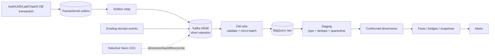

# ETL/ELT, event và CDC pipeline

## 1. Mục tiêu thiết kế

Pipeline phải thu nhận mọi sự kiện có giá trị phân tích mà không làm request người dùng phụ thuộc BigQuery/Kafka, không mất business mutation, replay được, và không tạo áp lực disk dài hạn trên K3s.

Đây là **ELT**: source chuẩn hóa contract tối thiểu; warehouse giữ raw; logic dimensional chạy trong BigQuery. Dùng ETL ở edge chỉ cho masking, schema validation, size limit và loại secret.

## 2. Luồng canonical



### Delivery semantics

- Source DB + outbox insert: atomic.
- Outbox → Kafka: at-least-once.
- Kafka → BigQuery raw: at-least-once.
- Effective warehouse result: exactly-once by `event_id`, source primary key/version and deterministic `MERGE`.
- Event order is guaranteed only inside a partition key; SCD resolves by `(source_updated_at, source_sequence, ingested_at)`.

## 3. Standard event envelope

Mọi event mới dùng contract versioned:

```json
{
  "event_id": "uuid-v7",
  "event_type": "lms.enrollment.created",
  "schema_version": 1,
  "occurred_at": "2026-08-31T10:15:32.123Z",
  "produced_at": "2026-08-31T10:15:32.140Z",
  "producer": "lms-service",
  "environment": "prod",
  "actor": {
    "user_id": 295,
    "actor_type": "USER",
    "organization_id": 7
  },
  "context": {
    "request_id": "...",
    "trace_id": "...",
    "session_id": "...",
    "course_id": 58,
    "lesson_id": 120
  },
  "subject": {"type": "enrollment", "id": "991"},
  "privacy_class": "INTERNAL",
  "payload": {}
}
```

Rules:

- Timestamp UTC, millisecond precision; UI chuyển timezone.
- `event_id` không tái tạo khi retry.
- `schema_version` chỉ tăng khi breaking change; consumer hỗ trợ N và N-1.
- `actor.user_id` là người kích hoạt; `subject` là entity bị tác động.
- Payload không chứa token, password, Authorization header, raw prompt/response hoặc file body.
- Giới hạn kích thước mặc định 64 KiB; file/object chỉ lưu URI + metadata đã kiểm soát.

## 4. Khi nào event, outbox, CDC hay snapshot

| Nhu cầu | Cơ chế | Lý do |
|---|---|---|
| Login attempt/success, UI feature use, recommendation impression | Domain event | Không nhất thiết tồn tại thành row trạng thái |
| Enrollment/course/lab mutation mới | Transactional outbox | Atomic với business write, giàu business meaning |
| Dimension hiện có chưa có event | CDC có chọn lọc | Capture insert/update/delete ít xâm lấn |
| Initial history/backfill | Consistent snapshot | CDC không tạo lại lịch sử trước slot |
| Reconciliation | Incremental snapshot bằng `updated_at` + PK | Phát hiện miss/drift |
| High-volume click/heartbeat | Gộp client telemetry, rate/sample | Bảo vệ Kafka, privacy và chi phí |

Không dùng CDC cho “mọi bảng”. CDC row-level không biết business intent, có thể phát tán PII, tạo nhiều event kỹ thuật và giữ WAL nếu connector lỗi. Không dùng polling đơn thuần cho event không có row durable như login failure hoặc impression.

## 5. Transactional outbox

Mỗi DB domain có `analytics_outbox`:

```sql
CREATE TABLE analytics_outbox (
  event_id UUID PRIMARY KEY,
  aggregate_type TEXT NOT NULL,
  aggregate_id TEXT NOT NULL,
  event_type TEXT NOT NULL,
  schema_version SMALLINT NOT NULL,
  partition_key TEXT NOT NULL,
  payload JSONB NOT NULL,
  occurred_at TIMESTAMPTZ NOT NULL,
  published_at TIMESTAMPTZ,
  attempts INTEGER NOT NULL DEFAULT 0,
  last_error TEXT
);

CREATE INDEX analytics_outbox_unpublished
  ON analytics_outbox (occurred_at)
  WHERE published_at IS NULL;
```

Business service insert outbox trong cùng transaction. Relay dùng `FOR UPDATE SKIP LOCKED`, publish idempotently, rồi set `published_at`. Job housekeeping xóa rows đã publish sau 3–7 ngày theo batch nhỏ. Relay failure không làm fail user request.

## 6. CDC trên Neon

### Decision

CDC là Phase 2, chỉ dùng cho các dimension/state tables thiếu domain event và audit-critical changes. Kết nối bằng **direct endpoint**, không dùng hostname `-pooler`, vì logical replication là session dài và protocol replication không phù hợp transaction pooling.

Neon lưu ý:

- bật logical replication thay đổi `wal_level`, restart computes và không thể revert theo tài liệu hiện tại;
- subscriber active ngăn compute scale-to-zero;
- logical replication tính vào public network transfer;
- inactive/lagging slot có lifecycle và WAL retention risk;
- mỗi database/connector cần publication và replication slot riêng.

Vì production hiện dùng chung Neon project/endpoint cho nhiều logical database, cần inventory chính xác database nào nằm cùng project. Không chạy câu lệnh `ALTER SYSTEM`; Neon bật logical replication từ Console/API quản trị.

### CDC allowlist ban đầu

| Source | Tables | Purpose | Excluded columns |
|---|---|---|---|
| Auth | users, roles/memberships, organizations | `dim_user`, role/org history | password hash, reset/MFA secrets |
| LMS | courses, sections, section_content, enrollments | content/course dimensions, enrollment lifecycle | raw file body |
| Lab | labs, lab_versions, environment_templates | lab/version dimensions | hidden testcase expected output if restricted |
| AI | llm_models, task bindings | model/task config history | provider API keys |
| AI | llm_usage_log after context migration | LLM call fact | error message sanitized/truncated |

Chat messages, agent messages and uploaded document text are not in default CDC allowlist.

### CDC safeguards

- Dedicated least-privilege replication user.
- `table.include.list` and column exclusion explicit.
- Alert `restart_lsn`, `confirmed_flush_lsn`, retained WAL bytes and last event age.
- Pause writes/escalate if retained WAL crosses threshold.
- Heartbeat table/topic.
- Document recovery after Neon branch restore/removal of slot.
- Snapshot mode and schema history stored durably outside pod ephemeral disk.

## 7. Kafka topic strategy

Reuse domain topics where contract đủ tốt; không mirror mỗi database table thành một topic nếu không cần.

| Topic | Key | Partitions initial | Retention | Mode |
|---|---|---:|---:|---|
| `analytics.identity.v1` | user_id | 1 | 72h | delete |
| `analytics.learning.v1` | user_id | 3 | 72h | delete |
| `analytics.lab.v1` | user_id | 1 | 72h | delete |
| `analytics.chat.v1` | user_id | 1 | 24h | delete |
| `analytics.ai-usage.v1` | user_id/job_id | 1 | 72h | delete |
| `analytics.mcp.v1` | user_id | 1 | 72h | delete |
| `cdc.<domain>.<table>.v1` | PK | 1 each | 24–72h | compact + delete |
| `analytics.dlq.v1` | source event_id | 1 | 7d | delete |

Không tạo mặc định “8 topics × 3 partitions”. Partition count tăng khi một partition không đáp ứng measured throughput hoặc cần consumer parallelism. Replication factor hiện là 1 nên Kafka không HA; sink không được xem Kafka là bản lưu duy nhất dài hạn.

Producer settings: `acks=all`, idempotence khi client hỗ trợ, LZ4 hoặc Zstd, bounded retry, no sensitive logging. Topic schemas lưu JSON Schema trong Git; schema registry có thể bổ sung khi volume/team tăng.

## 8. Raw ingestion và idempotency

Raw table chung theo event family, partition bằng `DATE(ingested_at)`, cluster `event_type, source`:

```sql
CREATE TABLE bdc_raw_prod.events (
  event_id STRING NOT NULL,
  event_type STRING NOT NULL,
  schema_version INT64 NOT NULL,
  source STRING NOT NULL,
  occurred_at TIMESTAMP NOT NULL,
  produced_at TIMESTAMP,
  ingested_at TIMESTAMP NOT NULL,
  kafka_topic STRING,
  kafka_partition INT64,
  kafka_offset INT64,
  payload JSON,
  payload_sha256 STRING,
  validation_status STRING,
  validation_errors ARRAY<STRING>
)
PARTITION BY DATE(ingested_at)
CLUSTER BY event_type, source
OPTIONS (require_partition_filter = TRUE);
```

Sink ghi cả Kafka coordinates. Staging chọn một row bằng:

```sql
QUALIFY ROW_NUMBER() OVER (
  PARTITION BY event_id
  ORDER BY ingested_at DESC, kafka_offset DESC
) = 1
```

Quarantine không chặn batch hợp lệ. Unknown schema version đi DLQ/quarantine và không commit “success” vào conformed layer.

## 9. Watermark và late data

Mỗi source có watermark trong `bdc_governance.pipeline_watermarks` gồm source, partition, last offset/LSN, max occurred_at, run_id và checksum. Transform facts đọc partition mới + lookback 48 giờ. SCD correction hỗ trợ event đến trễ bằng recompute timeline của đúng natural key; không chỉ update current row.

Daily marts ở trạng thái provisional trong D+2, sau đó final; backfill vẫn được phép và ghi `recomputed_at`.

## 10. AI usage pipeline

### Gap phải sửa ở source

`llm_usage_log` đã có task/model/token/latency/success/fallback/attempt/request nhưng thiếu actor/context. Migration source cần thêm:

```sql
ALTER TABLE llm_usage_log
  ADD COLUMN user_id BIGINT,
  ADD COLUMN session_id UUID,
  ADD COLUMN course_id BIGINT,
  ADD COLUMN job_id VARCHAR(120),
  ADD COLUMN trigger_type VARCHAR(32),
  ADD COLUMN tool_name VARCHAR(160),
  ADD COLUMN parent_request_id VARCHAR(120);
```

Context nên đặt bằng request-scoped `ContextVar`/explicit job context ở gateway, không sửa thủ công rời rạc từng adapter. Worker command phải mang `triggered_by`, user/course/job/trace. Một logical user action có thể tạo nhiều LLM attempts; fact grain là attempt, còn action/session/job fact aggregate bằng correlation IDs.

Cost được snapshot trên fact tại call time:

```text
cost = prompt_tokens × input_price_per_token
     + completion_tokens × output_price_per_token
     + cached/image/audio/tool provider charges nếu có
```

Không backfill cost bằng “giá hiện tại” rồi coi là historical actual. Local model ghi currency/cost = 0 nhưng vẫn ghi tokens hoặc compute duration/GPU seconds.

Indexing phải tách:

- extraction/VLM LLM calls;
- embedding input tokens/chunks/dimensions/model;
- reranking calls;
- vector write count/bytes;
- total job duration/status/retry/cancel.

## 11. MCP telemetry pipeline

`mcp_audit_log` hiện có `key_id`, `user_id`, `action`, `success`, JSON metadata và time. Bổ sung contract:

- `request_id`, `trace_id`, `session_id`;
- `tool_name`, tool version, read/write risk class;
- `course_id`, target entity type/id;
- `latency_ms`, result status/error class;
- `client_name` (Claude/Codex/OpenCode/other) do client khai báo, không tin dùng cho auth;
- bytes in/out và item count đã sanitize;
- API key id/prefix được phép, raw bearer token không bao giờ log;
- nếu MCP tool gọi LLM, link `llm_usage_log.parent_request_id` để không double count.

MCP audit event được ghi durable trước, publish qua outbox; write tool bắt buộc authorization ở LMS tại execution time. Warehouse không được cấp quyền gọi ngược tool.

### Local-knowledge privacy

File local được MCP client đọc không phải nguồn dữ liệu của BDC và không được đưa vào warehouse. BDC chỉ quan sát được MCP calls thực sự đến server. Không log local path, filename, source alias, file hash, excerpt, prompt hoặc nội dung draft chưa gửi.

Nếu client tự nguyện khai báo context, telemetry chỉ được phép giữ controlled fields như `knowledge_mode = LMS_ONLY | LOCAL_ONLY | HYBRID` và `local_context_used = true`; đây là client claim, không phải bằng chứng BDC đã đọc file. Khi giáo viên duyệt một derived Markdown lesson, warehouse ghi business event tạo lesson và MCP attribution như bình thường, nhưng không suy diễn hay lưu fingerprint của source file local.

## 12. Failure and replay runbook

1. Sink lỗi: application tiếp tục; Kafka giữ event trong retention.
2. BigQuery quota/auth lỗi: exponential backoff, không commit offset, alert trước khi retention window hết.
3. Poison event: ghi DLQ/quarantine với redacted error, commit offset để không kẹt partition.
4. Duplicate: raw có thể duplicate; staging/core dedupe.
5. Lost Kafka window: chạy source reconciliation snapshot theo `updated_at`/PK; event-only facts cần outbox chưa purge hoặc backup.
6. CDC lag: monitor WAL; nếu unsafe, stop connector có kiểm soát, snapshot lại theo runbook, không drop slot mù quáng.
7. Schema breaking: producer deploy compatibility trước, consumer hỗ trợ dual version, rồi cleanup.

## 13. Data quality gates

- uniqueness: event IDs, dimension current row, source fact IDs;
- not-null: natural keys, grain columns, occurred time;
- accepted values: event/status/actor/trigger types;
- relationships: fact dimension key resolve rate;
- freshness: per source SLA;
- reconciliation: source daily counts/sums vs warehouse;
- privacy scan: token/key/email/IP patterns in forbidden columns;
- volume anomaly: row count and bytes deviation.
