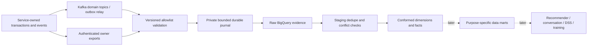
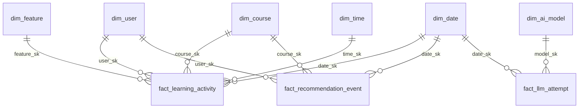

# Warehouse foundation and source contracts

Owner: platform/data team, with each service owning its source contracts.
Scope: source discovery, collection, storage, analysis and dimensional modelling.
New data marts, dashboard applications, recommendation serving, conversational
recommendation serving and DSS workflows are deferred by the product owner.

## 1. Business requirements and system boundary

The warehouse must preserve trustworthy evidence for three future consumers:

1. Learners and instructors: learning progression, difficulties, explainable
   interventions, recommendation exposure/outcomes, conversational preferences.
2. Administrators: observed users, exact activity times, feature use, service
   health and attributable AI activity, usage, latency, failures and cost.
3. Data/AI teams: versioned, provenance-aware feedback and training/evaluation
   datasets for improved models, adaptation and learnable harnesses.

DW data is subject-oriented, integrated, time-variant and normally nonvolatile.
Operational services execute transactions; the warehouse integrates historical
evidence without becoming their shared database. Controlled erasure and retention
still apply to immutable evidence. MSS is the broader family of management
support systems; a DSS combines data, models and human judgement for partly
structured decisions. The DW supplies historical evidence to that model layer.

Future DSS phases are intelligence (detect a supported difficulty), design
(generate feasible interventions), choice (compare evidence and constraints),
implementation (human-approved action), and monitoring (observe outcomes).
Recommendation and conversational recommendation are consumers in that cycle,
not substitutes for source data, policy or evaluation.

## 2. Source discovery before ingestion

The executable source register is [sources.json](../contracts/sources.json).
An implemented consumer or a topic name does not establish a working producer.
Discovery records ownership, actual publisher/export code, natural key, grain,
time semantics, privacy, capture method and known gaps. Live inspection establishes
topic presence/partitions; a reconciled batch establishes actual collection.

| Owner | Evidence in the repository | Current foundation treatment |
|---|---|---|
| LMS | `pkg/kafka/events.go`, `internal/service/micro_interaction_service.go` | Existing real Kafka events; preserve original interaction ID |
| Recommender | `app/service.py:log_interaction`, `app/schemas.py` | Existing Kafka outcomes; strip tracking tokens and arbitrary metadata |
| AI gateway | `app/core/llm_gateway/usage.py`, `llm_usage_log` | Source-owned bounded export/outbox; preserve one row per attempt |
| AI agent | `agent_sessions`, `agent_messages`, `agent_telemetry_logs` | Inventory and provenance contract; raw content not in general-purpose DW |
| Auth | password and Google login in `AuthController` | Producer gap; successful refresh is not an interactive login |
| Lab | owned lab/submission/runtime data and job events | Separate submission facts from runtime job status; owner export required |
| Chat | owned messages/reactions/membership and WebSocket hub | Metadata only; HTTP requests do not measure messages or presence duration |
| Personalize | owned DuckDB profiles, `personalize.profile.updated` | Derived evidence; retain derivation/policy version, never count as raw learning events |
| Observability | Prometheus application counters/histograms | Future service-minute snapshots; a metric snapshot is not user activity |

No warehouse process connects to an application's PostgreSQL or live DuckDB.
Historical exports execute in the owning service behind internal authentication.
Never infer actor attribution from timestamp proximity, a prompt, an IP address
or a client-supplied user identifier.

## 3. Storage and ELT architecture

The ingestion contract is at least once. Stable source event identity and payload
hashes make core derivations repeatable; an acknowledged BigQuery load precedes
Kafka offset advancement. A private SQLite journal survives process restart.
It does not survive arbitrary node/PVC loss: this remains a single-node deployment.
The Kafka replay window and confirmed target jobs determine recovery feasibility.

Raw has event time and actual ingestion time, exact source coordinates, source
schema version, canonical hash and a typed/allowlisted payload. Transport retries
may create multiple deliveries. Staging exposes one canonical event only when
all deliveries agree on the payload. Conflicting identities are visible in
governance and excluded from facts, never silently resolved by latest arrival.

Validation precedes raw landing. Unknown contracts, malformed timestamps,
non-finite scores, oversized records and invalid keys block acknowledgement.
There is no automatic poison-record discard. A future durable quarantine must
define retention, replay and the acknowledgement boundary before activation.

Late events are discovered by ingestion time, then assigned to event-time dates.
Timezone is `Asia/Ho_Chi_Minh` for reporting, UTC for stored instants. No event-time
lookback alone determines whether an event is retained. Historical source exports
declare their consistency boundary and reconciliation period; serial IDs alone
are not commit order and cannot prove that no earlier transaction is still open.

## 4. Dimensional design

Follow the Kimball sequence: business process, exact grain, dimensions, facts.
Use a constellation of stars with conformed dimensions; do not make one wide
fact table mixing logins, learning events and provider attempts.

| Fact | Exact grain | Additive measures | Key dimensions / correlation |
|---|---|---|---|
| Learning activity | One original LMS micro-interaction | Event count | User, course, feature, date/time, lesson/node |
| Recommendation event | One impression/click/accept/etc. event | Event count | User, course, recommendation/set, rank, surface |
| LLM attempt | One recorded provider attempt | Reported tokens, known currency-compatible cost | Model/provider/task, request, actor when propagated |
| Login | One interactive authentication event | Login count | User when verified, method, exact time/session |
| Agent turn | One user turn and its observable result | Turn count, known latency | Session/turn, user/course, policy and output artifact |
| Tool execution | One observable tool invocation | Calls, known duration | Tool/version, turn, request, outcome |
| Learner state | User × course/skill × snapshot instant | Most measures semi-additive over time | Evidence version, completeness, observation window |

Only backed sources are instantiated. Login/session facts remain unavailable
until an in-repository producer and end-to-end evidence exist. Zero login rows
are not evidence of zero logins. A lesson view is not a login, completion or
session duration. Quiz success is inferred only from its explicit source action;
unversioned numeric scores are not assumed to share a scale.

Source-scoped deterministic SHA-256 surrogate keys preserve natural keys.
Observed-key user/course dimensions are explicitly inferred members, with unknown
descriptions rather than invented names or roles. Facts retain natural keys for
later binding. Source-owned snapshots will enrich those members; only authentic
source versions may establish SCD2 effective intervals. Do not fabricate role or
course history from the first observed interaction. Calendar/time dimensions are
deterministic calendar derivations, not fabricated business events.

The initial stars use logical dimensions/facts to fit the billing-disabled mode.
This is dimensional modelling even when the physical serving objects are views.
Schema, grain, relationships and semantics remain explicit. Persistent SCD2 and
incremental materialization require a separate retention/billing decision.
See [the broader modelling catalog](03-data-warehouse-modelling.md) for the target
SCD, bridge and snapshot conventions.

Distinct users are not additive across days/features/courses. Percentiles cannot
be averaged. Aggregate unrelated facts separately before joining common-grain
results to avoid multiplying interactions, costs or tool counts. Unresolved AI
usage or cost stays null with a measurement status; a missing value is not zero.

## 5. AI and learnable-harness evidence

Model training requires more than prompt/answer pairs. Preserve externally
observable evidence and its provenance:

- Trace/request, conversation/session, turn, parent call, attempt and artifact IDs.
- Authenticated actor/course scope when actually propagated; otherwise null.
- Task, model/provider, routing/harness/tool/prompt-template versions.
- User input and final output artifact references, hashes and access classification.
- Retrieval document IDs/versions, observable tool arguments/results after privacy
  filtering, tool outcomes, latency, reported usage, retry/fallback and failure class.
- Explicit user/instructor/verifier feedback, scorer/version, label origin and time.
- Consent/purpose, allowed uses, retention, erasure lineage and split membership.

Raw prompts, message bodies, learner code, credentials and unrestricted tool
payloads do not enter general raw/core datasets. Content belongs to a separately
authorized, redacted artifact store with audited access and deletion propagation;
the warehouse holds references and provenance. No hidden chain-of-thought is
needed for this contract. Existing traces lacking actor/context or immutable
artifact versions are not retroactively declared training-ready.

Future curation manifests freeze source event/artifact hashes, feature/label code
versions, eligibility, purpose and time boundaries. Split by user/course and time
where appropriate to prevent leakage; keep a frozen evaluation set separate from
policy adaptation. Generated answers and model self-ratings are not ground-truth
labels. A learnable harness is evaluated offline and shadowed before promotion;
these model-training and serving components are explicitly outside this phase.

Recommendation events retain recommendation/set IDs and separate impressions
from outcomes. Conversational recommendations additionally require session/turn,
elicited preferences, candidate-set/version, constraint/reason evidence and user
choice. Never infer CTR from clicks without an observed, eligible denominator or
causal learning improvement from observational click data alone.

## 6. Quality, lineage and analysis gates

Every onboarded source must pass:

1. Contract/schema checks before landing; schema changes are versioned.
2. Stable identity, hash conflict and replay-equivalence checks.
3. Source coordinate/record-count reconciliation within a declared capture window.
4. Key uniqueness and fact-to-dimension relationship checks.
5. Timestamp, nullable-measure and allowed-category checks.
6. Freshness/coverage reporting that separates absent source, no events, delayed
   ingestion, expired target and actual business zero.
7. Privacy allowlist and secret-exclusion tests.

Analysis commands return metadata and aggregates by default. No source records or
identifying dimensions are printed into CI or committed. Data quality results
must include query/job ID, model version, checked window, counts and pass/fail;
a green unit test or ready pod alone is not live ingestion evidence.

## 7. Resource and retention constraints

Keep BigQuery billing disabled. Use bounded batch loads, partition pruning,
selective projections, source-key clustering, stable job IDs and maximum bytes per
query. Reuse one bounded consumer before adding distributed ETL frameworks.
Avoid per-click database connections and synchronous warehouse calls on learning
requests. Only owner-controlled outboxes/snapshots touch operational databases.

BigQuery Sandbox expires tables/views/partitions after 60 days. Current raw expiry
was verified as `2026-12-20T15:10:44.388Z`; this is not permanent DW retention.
Expiry must stop unsafe acknowledgements, and restoration must reconcile table
incarnation and Kafka checkpoints. Longer historical retention needs an approved
archive and restore exercise or a separately authorized funded configuration.
Never enable billing or extend source retention implicitly.

## 8. Acceptance and academic evidence

| Learning outcome | Foundation evidence / later boundary |
|---|---|
| L.O.1.1–1.3 | DW/DSS definitions, education/admin examples and evidence flow above |
| L.O.2.1–2.2 | Source register, four-step grain design, privacy, late data, additivity, retention |
| L.O.2.3 | Executable raw/staging/core SQL, real ingestion, relationship/quality checks |
| L.O.3.1–3.3 | MSS/DSS distinction and decision phases; future evidence-to-model contract |
| L.O.4.1 | Explainable intervention and recommendation design, human choice and evaluation |
| L.O.4.2 | DSS application implementation is deferred with data marts by the product owner |

The complete assignment will also require the deferred API/dashboard and DSS
deliverables. The foundation must not be presented as completion of those items.

## References

- [Kimball four-step dimensional design](https://www.kimballgroup.com/data-warehouse-business-intelligence-resources/kimball-techniques/dimensional-modeling-techniques/four-4-step-design-process/).
- [BigQuery computation optimization](https://docs.cloud.google.com/bigquery/docs/best-practices-performance-compute).
- [BigQuery Sandbox constraints](https://docs.cloud.google.com/bigquery/docs/sandbox).
- [Existing production receipt](../../docs/warehouse-production-status.md).
